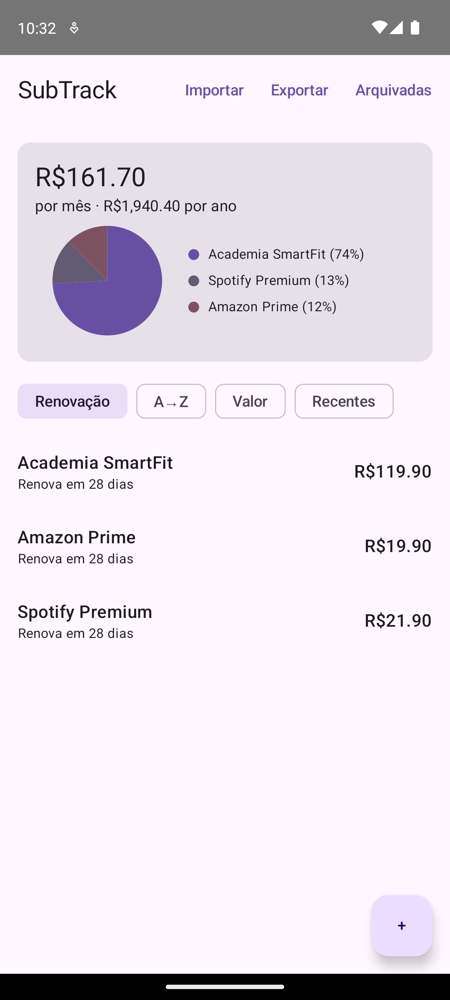
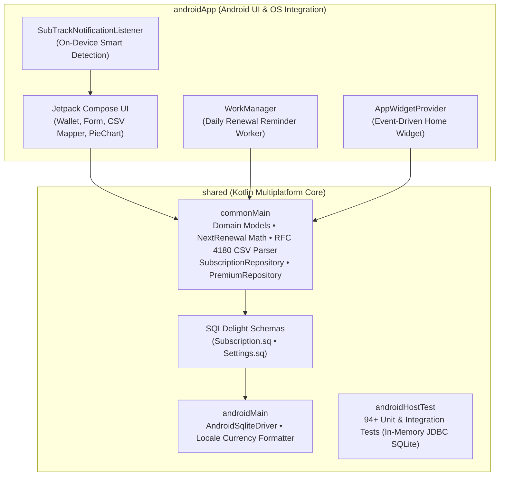

# SubTrack


**SubTrack** is a privacy-first subscription tracker built with **Kotlin Multiplatform (KMP)**, **Jetpack Compose**, and **SQLDelight**. It bridges the gap between invasive financial apps that require bank credentials (Plaid) and overly simplistic trackers that lack automation, widgets, and data portability.

<p align="center">
  
</p>

---

## ✨ Key Features

- **100% Offline & Zero-Network Privacy:** SubTrack requests **zero internet permissions** (`INTERNET` is absent and `ACCESS_NETWORK_STATE` is explicitly stripped from manifest merges). Financial data never leaves the device.
- **Anchor-Based Renewal Engine:** Stores an immutable billing anchor (`anchorEpochDay`) and derives upcoming renewal dates dynamically across weekly, monthly, yearly, and custom `everyN` intervals—handling leap years and short months without stale state.
- **Smart Notification Tracker (Opt-in):** Local `NotificationListenerService` that detects subscription charges from bank card notifications on-device and offers a one-tap pre-filled subscription draft.
- **Visual Spending Breakdown & Multi-Currency Totals:** Aggregates monthly and annual recurring costs per currency (`BigDecimal` fixed-scale math, zero floating-point drift) with an interactive spending distribution chart.
- **RFC 4180 CSV Import & Export:** Full roundtrip backup/restore for SubTrack exports plus an interactive column-mapping screen (`ImportScreen`) to import spreadsheets or exports from other apps via Android's Storage Access Framework (SAF).
- **Zero-Polling Home Screen Widget:** Displays monthly totals and the next upcoming renewal using event-driven `RemoteViews` updates (`updatePeriodMillis = 0`), preserving battery life.
- **Deduplicated Renewal Reminders:** Daily `WorkManager` background checks with immediate startup execution and per-cycle notification deduplication (`lastNotifiedRenewal`) that survives device reboots.

---

## 🏗️ Architecture

SubTrack is structured for cross-platform scalability under **AGP 9** and **Kotlin Multiplatform**:



| Module | Responsibility |
| :--- | :--- |
| `shared/commonMain` | Domain models, anchor-based renewal calculation (`NextRenewal.kt`), recurring cost math, RFC 4180 CSV parser/exporter, and SQLDelight repositories. Zero Android dependencies. |
| `shared/androidMain` | Platform `actual` implementations for the SQLDelight driver and locale-aware `BigDecimal` currency formatting. |
| `shared/androidHostTest` | 94+ unit and integration tests running directly against an in-memory JDBC SQLite driver without requiring an emulator. |
| `androidApp` | Material 3 Compose UI, `WorkManager` notification scheduling, `NotificationListenerService` smart detection, and `RemoteViews` home widget. |

---

## 🧠 Notable Engineering Decisions

- **Billing Anchor vs. Mutable Next Renewal:** Storing a "next renewal date" in the database causes records to go stale if the user doesn't open the app for months. SubTrack persists `anchorEpochDay` (any verified billing occurrence) and computes `nextRenewalOnOrAfter(anchor, today)` deterministically at read time.
- **Cycle-Aware Notification Deduplication:** Instead of a boolean `notified` flag, the schema records the exact `lastNotifiedRenewal` epoch day. Editing a subscription's price preserves the notification state for the current cycle, while shifting the billing date automatically re-arms the alert.
- **Strict Permission Hygiene:** `WorkManager` merges `ACCESS_NETWORK_STATE` by default. Because Play Store displays network capabilities to privacy-conscious users, SubTrack strips it via `tools:node="remove"` in `AndroidManifest.xml`.

---

## 🚀 Getting Started

### Prerequisites
- **JDK 17+**
- **Android SDK** (`compileSdk 36`, `minSdk 26`)

### Build & Run Verification Gate
```bash
# Format, run ktlint checks, execute all 94+ tests, and assemble debug/release APKs
./gradlew ktlintFormat ktlintCheck build

# Run shared module unit & SQLite integration tests only
./gradlew :shared:allTests
```

---

## 📄 License

Copyright © Gabriel Brustolin Ziegemann. All rights reserved.

